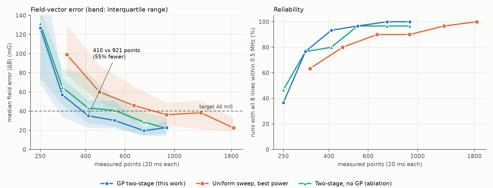
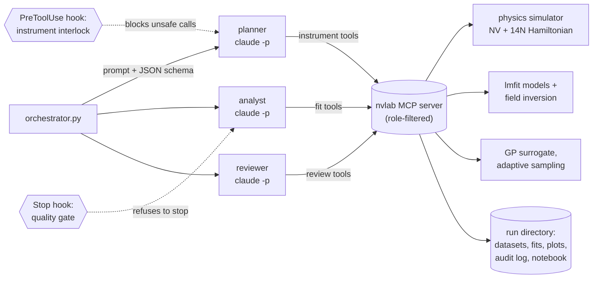

# nv-odmr-agent

[](https://github.com/Richen-X/nv-odmr-agent/actions/workflows/ci.yml)


An LLM lab agent that **plans, runs and analyses NV-centre magnetic-resonance measurements in a
closed loop**. Three [Claude Code](https://docs.claude.com/en/docs/claude-code) agents run headless,
each with its own role, tools and output schema: a **planner** that operates the instruments, an
**analyst** that fits the data and a **skeptical reviewer**. They work through an
[MCP](https://modelcontextprotocol.io) server that wraps a physics simulator, lmfit models and a
Gaussian-process sampler. Two deterministic hooks keep them honest: an instrument interlock the model
cannot override, and a quality gate the analyst cannot finish without passing.

The loop is developed against a simulator of NV-ensemble ODMR with realistic shot noise. That way
every component can be tested end to end, and scored against a known ground truth, before the
same tools are pointed at real hardware.

<picture>
  <source media="(prefers-color-scheme: dark)" srcset="docs/img/benchmark_dark.png">
  
</picture>

**Result (30 held-out synthetic samples).** To recover the field vector to a median error of
40 mG with at least 90 % reliability, the GP-guided strategy needs **410 points; the best uniform
sweep needs 921 (55 % fewer)**. With 730 points it reaches a median field error of **20 mG**
(90th percentile 30 mG) and a median worst-line error of 0.11 MHz, with all eight lines found in every
run. That matches or beats the densest 1841-point uniform sweep on every metric. Details:
[Benchmark](#benchmark).

## How it works



**Roles.** Each role is a separate `claude -p` process. It gets its own system prompt
([`roles/`](src/nvagent/roles)), a JSON schema for its final answer (`--json-schema`), and an MCP server
that exposes *only that role's tools*. The separation of duties is therefore enforced, not just
requested: the analyst cannot measure, and the reviewer can neither measure nor fit. Built-in tools are
disabled (`--tools ""`), permissions are pre-approved per tool (`--permission-mode dontAsk`), and every
invocation has a spending cap (`--max-budget-usd`). The orchestrator chains the roles through their
structured outputs and repeats planner → analyst → reviewer until the reviewer accepts or the round
limit is reached. It then scores the final answer against the hidden ground truth.

| role | tools | guardrail |
|---|---|---|
| planner | `get_instrument_info`, `measure_odmr_sweep`, `measure_odmr_points`, `find_odmr_lines`, `run_adaptive_odmr`, `measure_rabi`, `measure_t1` | PreToolUse interlock |
| analyst | `find_odmr_lines`, `fit_odmr`, `fit_field_vector`, `fit_rabi`, `fit_decay`, `view_fit_plot` | Stop-hook quality gate |
| reviewer | `get_fit_report`, `check_field_consistency`, `view_fit_plot` | read-only |

All roles also have `get_run_summary` and `add_notebook_entry`. `view_fit_plot` returns the fit as an
image, so the analyst and reviewer judge fits by eye as well as by numbers.

**Guardrails.**
- [`pre_tool_guard`](src/nvagent/hooks/pre_tool_guard.py) runs before every instrument call. It checks
  MW frequency and power, laser power, dwell, points per call and the run's total point budget against
  [`safety.py`](src/nvagent/safety.py). It blocks with exit code 2 and tells the model why. The MCP server
  applies the same checks again, so the interlock holds even without the hook.
- [`stop_quality_gate`](src/nvagent/hooks/stop_quality_gate.py) runs when the analyst tries to finish. It
  answers `{"decision": "block"}` until all of the following hold:
  - reduced χ² ≤ 2 and every line centre has an error ≤ 0.25 MHz;
  - no residual dip of 5σ or more remains unexplained (a missed line);
  - the fit includes all current data;
  - a single field vector explains every line.

  This turns "fit this data" into a verify-and-retry loop. After three refusals the stop is allowed and
  the failure recorded, so a run that cannot pass still ends and the reviewer sees why.
- Every tool call, interlock decision, measurement and fit is appended to `audit.jsonl` in the run
  directory, so a run can be audited and replayed.

**Physics simulator** ([`physics.py`](src/nvagent/physics.py), [`simulator.py`](src/nvagent/simulator.py)).
- **Hamiltonian:** for each of the four ⟨111⟩ orientations, the 9×9 electron + ¹⁴N Hamiltonian (D, E,
  Zeeman, A∥, A⊥, quadrupole, nuclear Zeeman) is diagonalised in an arbitrary bias field.
- **Transition strengths:** taken from the MW selection rules and the bright-state character of the
  eigenstates. The weak nuclear-spin-flip lines that off-axis fields allow come out on their own.
- **CW lines:** they saturate and power-broaden (depth ∝ s/(1+s), width ∝ √(1+s)), and optical pumping
  shifts saturation and broadens the intrinsic line.
- **Pulsed signals:** Rabi traces include off-resonant driving of every transition; T1 is a stretched
  exponential.
- **Noise:** counts are Poissonian, with optional technical noise and a baseline slope.
- **Validation:** checked against analytical limits in [`tests/test_physics.py`](tests/test_physics.py),
  including D ± γB for an axial field, the transverse two-level solution, the hyperfine triplet, the
  selection-rule sum rule and cubic symmetry.

**Analysis** ([`fitting.py`](src/nvagent/fitting.py), [`fieldfit.py`](src/nvagent/fieldfit.py), [`pipeline.py`](src/nvagent/pipeline.py)).
- **Line detection:** a matched filter picks the line-width class, and a sparse non-negative
  deconvolution into ¹⁴N-triplet templates finds the lines. Both work on any sampling pattern. The
  deconvolution explains all dips jointly, so two triplets about 3 hyperfine spacings apart are not
  mistaken for one line between them.
- **Line fits:** lmfit Lorentzian-triplet models with Poisson weights, so χ²_red ≈ 1 when the model is
  right. They come with residual diagnostics (runs test, local residual scans that flag missed lines).
- **Model selection:** backward elimination by Δχ² down to at most 8 lines, followed by a
  hyperfine-alias check.
- **Field inversion:** a multi-start least-squares fit of B and D to the line centres, with
  uncertainties from the Jacobian. B is reported in canonical form because an ensemble cannot
  distinguish the 48 cubic-symmetry-equivalent fields.

**Adaptive sampling** ([`adaptive.py`](src/nvagent/adaptive.py)). No sampler can *find* a 1 MHz line
without covering the band at roughly 1 MHz resolution. The physics offers a shortcut, in two stages:
1. **Survey.** At high MW power the lines power-broaden to several MHz, so a 3 MHz survey (154 points)
   locates them all.
2. **Refinement.** At about 0 dBm, near the saturation (s ≈ 2) that maximises depth/width for locating
   line centres, a scikit-learn GP surrogate (Matérn-5/2, shot noise as known variance, length scale
   bounded by the physics to 0.3–3 MHz) chooses the next frequencies. In every batch it takes, in each
   window, the point that maximises σ·(predicted dip depth + βσ). That is an uncertainty-based
   acquisition weighted towards signal, and the per-window allocation keeps weak lines from being
   starved.

The LLM handles strategy (which powers, how many points, what to re-measure); the GP handles the
numerical search.

## Benchmark

[`benchmarks/adaptive_vs_uniform.py`](benchmarks/adaptive_vs_uniform.py) measures the same random
samples with every strategy. A sample has a random field direction, |B| = 25–70 G and eight resolvable
lines in 2640–3100 MHz. Every strategy uses the same 20 ms dwell per point and the same analysis
pipeline, and is scored against the hidden truth.

- **Fair baseline:** uniform sweeps get their best fixed MW power (−4, 0 or +4 dBm) at every step size.
- **No tuning on test data:** all tuning used seeds 1000–1019; the numbers below use seeds 0–29.
- **Target fixed in advance:** median field error ≤ 40 mG with ≥ 90 % of runs finding all eight
  lines within 0.5 MHz.

| method | points | runs with all 8 lines | median worst-line error | median / p90 field error |
|---|---|---|---|---|
| **GP two-stage** | **410** | 93 % | 205 kHz | **35 / 89 mG** |
| **GP two-stage** | **730** | **100 %** | **111 kHz** | **20 / 30 mG** |
| uniform, 0.5 MHz step (best power) | 921 | 90 % | 233 kHz | 36 / 98 mG |
| uniform, 0.25 MHz step (best power) | 1841 | 100 % | 161 kHz | 23 / 52 mG |
| two-stage with uniform windows, no GP (ablation) | 730 | 97 % | 142 kHz | 29 / 56 mG |

The full table is in [`benchmarks/results/summary.md`](benchmarks/results/summary.md) and the raw
per-run results are in [`benchmarks/results/adaptive_vs_uniform.json`](benchmarks/results/adaptive_vs_uniform.json).
The ablation isolates the GP itself: at equal points it lowers the median field error by about 30 %
relative to spreading the same refinement points uniformly over the same windows.

## Quickstart

```bash
git clone https://github.com/Richen-X/nv-odmr-agent && cd nv-odmr-agent
python -m venv .venv && source .venv/bin/activate      # Windows: .venv\Scripts\activate
pip install -e ".[dev]"
pytest                                                 # ~1 min; no API calls
```

Run the agent loop on a random synthetic sample (needs the [Claude Code CLI](https://docs.claude.com/en/docs/claude-code), logged in):

```bash
nvagent run --seed 3 --model sonnet --max-rounds 3 --budget 1200
```

Each run writes `runs/<timestamp>-seed<N>/`: datasets, fits and their plots, every agent's prompt and
raw output, `audit.jsonl`, the shared `notebook.md`, and `report.md` with the score against the
ground truth. To reproduce the benchmark (about 10 minutes on 16 cores):

```bash
python benchmarks/adaptive_vs_uniform.py --seeds 0-29
python benchmarks/plot_results.py
```

The MCP server also works on its own, for example from an interactive Claude Code session:
`python -m nvagent.mcp_server --role all --run-dir <run dir>`.

## Limitations

- **The instruments are simulated.** The tool layer is shaped for real drivers: replace the
  simulator calls in [`tools.py`](src/nvagent/tools.py) and keep the interlock, the gate and the
  analysis unchanged.
- **The simulator is simplified.** Lines are Lorentzian, E = 0, and there are no ¹³C neighbours and no
  slow drifts. Real spectra will add structure that the residual diagnostics and the reviewer should
  catch, and the thresholds will need retuning.
- **The benchmark compares acquisition strategies, not instrument overheads.** The LLM agents add
  decision latency and API cost on top of the measurement time.
- **The GP is a heuristic sampler.** A stationary GP learns its amplitude from all points, so it
  under-states dip depth in mostly flat data. The acquisition relies only on where dips are and how
  uncertain the GP is. A parametric Bayesian design over the line-shape model is the natural next step.

## Repository layout

```
src/nvagent/
  physics.py, simulator.py      NV Hamiltonian, ensemble transitions, virtual setup
  fitting.py, fieldfit.py       line finding, lmfit models, field-vector inversion
  pipeline.py, adaptive.py      guided analysis, GP-guided two-stage acquisition
  safety.py, qualitygate.py     interlock rules and quality gate (pure functions)
  tools.py, mcp_server.py       MCP tools and the role-filtered server
  hooks/                        PreToolUse interlock, Stop-hook quality gate
  roles/                        system prompts and JSON schemas of the three agents
  orchestrator.py, runstate.py  closed loop, run directory, scoring
benchmarks/                     acquisition benchmark, figures, results
tests/                          57 tests, including hooks run as subprocesses and a fake `claude`
docs/design.md                  design decisions and what the debugging taught
```

Developed with Claude Code, which also serves as the agent harness here.
